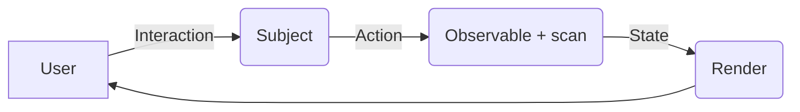

# Action – Reaction Pattern (MVI Architecture)

## 🌟 Tổng quan

Bài học này giới thiệu mô hình **Action–Reaction** (hay còn gọi là **MVI — Model View Intent**). Đây là một biến thể của Uni-directional Data Flow (luồng dữ liệu một chiều), giúp tách biệt hoàn toàn giữa việc **người dùng muốn làm gì** (Intent) và **hệ thống xử lý thế nào** (Model).

Thay vì viết một handler cho mỗi nút bấm — mỗi handler tự thay đổi state rồi tự gọi render — toàn bộ sự kiện người dùng được đưa vào **một dòng chảy duy nhất**, và state là **kết quả tính toán thuần túy** từ dòng chảy đó.

## 💎 Giá trị cốt lõi

1.  **Tách biệt (Decoupling)**: UI không gọi trực tiếp logic xử lý. UI chỉ gửi "Intent" (tôi muốn làm A).
2.  **Dễ test**: Vì logic nằm trọn trong các Observable thuần túy, không phụ thuộc UI — feed Action vào, so state ra (kết hợp với [TestScheduler](../../3_deep_dives/5_testing)).
3.  **Predictable (Dễ đoán)**: Trạng thái (State) được sinh ra từ một chuỗi các Action nối tiếp nhau — muốn debug, chỉ cần log lại chuỗi Action.
4.  **Không có state rời rạc**: chỉ một nguồn state duy nhất; không còn "biến này quên cập nhật ở nhánh đó".

## 🏗 Cấu trúc Pattern

Pattern gồm 3 phần chính:

1.  **Intent (Action)**: Đầu vào. Người dùng click nút, gõ phím... Các sự kiện này được chuẩn hóa thành đối tượng Action và đẩy vào một `Subject`.
2.  **Model (Reaction/State)**: Bộ não. Lắng nghe Intent, xử lý (gọi API, tính toán), trả về state mới. Operator quan trọng nhất là `scan` (hoặc `mergeScan` khi cần gọi API bên trong).
3.  **View**: Phần hiển thị. Chỉ việc `subscribe` vào Model và vẽ giao diện dựa trên State nhận được.



## 💡 Ví dụ hoàn chỉnh: counter với 3 action

Xem file `action_reaction.js` trong thư mục này. Dưới đây là bản TypeScript đầy đủ để đối chiếu:

```typescript
import { Subject, Observable, fromEvent, merge } from 'rxjs';
import { scan, map } from 'rxjs';

// ── 1. Định nghĩa Action (Intent) ───────────────────────────────
type Action =
  | { type: 'increment' }
  | { type: 'decrement' }
  | { type: 'reset' };

// ── 2. State ────────────────────────────────────────────────────
interface State {
  count: number;
}
const initialState: State = { count: 0 };

// Reducer thuần túy: (state, action) => state mới — KHÔNG đụng vào UI
function reducer(state: State, action: Action): State {
  switch (action.type) {
    case 'increment': return { ...state, count: state.count + 1 };
    case 'decrement': return { ...state, count: state.count - 1 };
    case 'reset':     return initialState;
  }
}

// ── 3. Gom mọi nguồn sự kiện thành một stream Action ────────────
const actions$: Subject<Action> = new Subject();

// View: từ DOM event, chỉ "dịch" thành Action — không xử lý gì thêm
const incrementClicks$ = fromEvent(incBtn, 'click').pipe(map(() => ({ type: 'increment' } as const)));
const decrementClicks$ = fromEvent(decBtn, 'click').pipe(map(() => ({ type: 'decrement' } as const)));
const resetClicks$     = fromEvent(rstBtn, 'click').pipe(map(() => ({ type: 'reset' } as const)));

merge(incrementClicks$, decrementClicks$, resetClicks$)
  .subscribe((action) => actions$.next(action)); // mọi intent đổ về một Subject

// ── 4. Model: state = scan(reducer) ─────────────────────────────
const state$: Observable<State> = actions$.pipe(
  scan(reducer, initialState)
);

// ── 5. View: render từ state — cách duy nhất UI đổi ─────────────
state$.subscribe((state) => {
  countEl.textContent = String(state.count);
});
```

Đọc lại luồng: **bấm nút → Action → reducer → state → render**. Không handler nào đụng vào `countEl` ngoài View; không một dòng nào trong reducer biết DOM tồn tại.

## 🔑 Vì sao `scan` là trái tim của pattern

`scan((state, action) => stateMới, initialState)` giống `reduce` của Array nhưng phát kết quả **sau mỗi Action**:

```text
actions$:  ─── inc ─── inc ─── reset ─── dec ───
state$:    ─── {1} ─── {2} ─── {0} ──── {-1} ──
```

Mỗi giá trị của `state$` là **toàn bộ trạng thái ứng dụng tại một thời điểm**. Không có biến "hiện tại" nào bị thay đổi chỗn chỗ — lịch sử có thể tái tạo được (thậm chí làm Undo/Redo được, xem [5_practices](../../5_practices)).

## 🚀 Nâng cấp 1: Action cần gọi API — mergeScan

Khi một Action phải chờ API (ví dụ: "thêm vào giỏ hàng"), `scan` thuần túy không đủ vì nó đồng bộ. Dùng `mergeScan` — scan bất đồng bộ:

```typescript
import { mergeScan, EMPTY } from 'rxjs';

const state$ = actions$.pipe(
  mergeScan(async (state, action) => {
    switch (action.type) {
      case 'addToCart':
        // chờ server xác nhận rồi mới cập nhật state
        const cart = await fetch('/api/cart/add', { method: 'POST' }).then((r) => r.json());
        return { ...state, cart };
      default:
        return reducer(state, action as Action);
    }
  }, initialState, /* concurrent: */ 1) // 1 = xử lý tuần tự, giữ đúng thứ tự Action
);
```

> `concurrent: 1` biến `mergeScan` thành "scan có xếp hàng" — tương đương tinh thần `concatMap`: các Action API được xử lý lần lượt, không chồng chéo.

## 🚀 Nâng cấp 2: chuẩn hóa Action bằng Subject có kiểu

Đừng để mỗi nút một Subject riêng — một `Subject<Action>` duy nhất giúp log, replay, test toàn bộ dòng đời của app:

```typescript
// Log toàn bộ intent (debug "tại sao state thành thế này?")
actions$.subscribe((a) => console.debug('[action]', a));

// Test không cần DOM: đẩy Action giả vào, so state ra
actions$.next({ type: 'increment' });
actions$.next({ type: 'increment' });
// state$ hiện tại phải là { count: 2 }
```

## ⚠️ Những cạm bẫy thường gặp

1.  **State phải là immutable.** `scan` cần trả **object mới** (`{ ...state, count }`) chứ không biến đổi object cũ — nếu không, View và mọi toán tử so sánh (`distinctUntilChanged`) không thấy thay đổi.
2.  **Quên `startWith(initialState)`** nếu dùng nguồn không phải Subject (ví dụ `merge` trực tiếp các event stream) — View sẽ không nhận state đầu tiên.
3.  **Gọi API trực tiếp trong reducer đồng bộ** — dùng `mergeScan` thay thế.
4.  **Không subscribe `state$` nhiều nơi bằng các subscription rời rạc** — dùng `shareReplay({ bufferSize: 1, refCount: true })` (xem [1_hot-vs-cold](../../3_deep_dives/1_hot-vs-cold)) để state là một nguồn hot duy nhất.
5.  **Memory leak khi component hủy** — View phải `takeUntil(destroy$)` (xem [2_memory-management](../../3_deep_dives/2_memory-management)).

## 📌 Tóm tắt

| Vai | Thứ được trao | Thứ không được làm |
| --- | --- | --- |
| View | Gửi Action, render State | Không xử lý logic, không ghi state |
| Model (scan/mergeScan) | Tính State mới từ (state, action) | Không biết UI tồn tại |
| Action | Mô tả "điều gì vừa xảy ra" | Không chứa logic xử lý |

## 🆚 So sánh với các cách quản lý state khác

| Cách | RxJS pattern tương ứng | Khi nào chọn |
| --- | --- | --- |
| Biến module-level + hàm setter | — (imperative thuần) | App cực nhỏ, 1 màn hình, state đơn |
| Service + BehaviorSubject | [1_state-management](../1_state-management) | State thay thế nguyên khối, ít phép tính |
| Action–Reaction (MVI) | Bài này | State là kết quả tích lũy của nhiều hành động |
| Redux/NgRx | Cùng tư duy Action/Reducer, thêm middleware | App rất lớn, cần time-travel, ecosystem |

MVI không thay thế Redux — nó là **bản tối giản** của cùng tư duy, không cần thư viện nào ngoài RxJS. Khi app phát triển, chuyển từ `scan` sang NgRx gần như chỉ là đổi chỗ đặt reducer.

## 🎯 Bài tập tự làm

Để kiểm tra bạn thực sự nắm pattern, hãy tự triển khai (không xem đáp án trước):

1. **Todo list**: ba Action `add`, `toggle`, `remove`; state là mảng todo. Yêu cầu: Action `add` phải qua `mergeScan` vì cần server xác nhận ID.
2. **Máy đếm có lịch sử**: state là `{ value, history: number[] }`; Action `undo` lấy phần tử cuối của `history` — không cần thêm thư viện.
3. **Giỏ hàng có khóa**: trong khi đang gọi API "thêm vào giỏ", mọi Action `add` tiếp theo phải **xếp hàng** (gợi ý: `mergeScan` với `concurrent: 1`).

Sau khi làm xong, kiểm chứng bằng TestScheduler: đẩy chuỗi Action giả, so state phát ra với chuỗi kỳ vọng — bạn đã có test cho toàn bộ logic ứng dụng mà không cần render UI.
