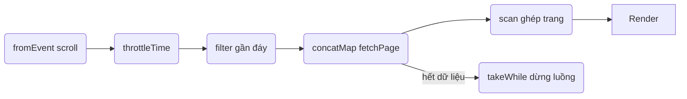

# Infinite Scroll — Tải thêm khi cuộn trang

## 🌟 Vấn đề

Danh sách dài (feeds, kết quả tìm kiếm, sản phẩm) không nên tải toàn bộ một lần. Cách chuẩn UX hiện nay là **infinite scroll**: cuộn tới gần đáy thì tự động tải trang tiếp theo.

Yêu cầu kỹ thuật phức tạp hơn vẻ ngoài:

1. **Không tải trùng trang** — scroll event bắn hàng chục lần/giây, phải đảm bảo mỗi trang chỉ được tải một lần.
2. **Giữ đúng thứ tự** — trang 4 không được chen giữa trang 3 nếu trang 3 chậm hơn.
3. **Tôn trọng nhịp người dùng** — đừng gọi API 20 lần vì người dùng cuộn đi cuộn lại.
4. **Dừng đúng lúc** — hết dữ liệu thì thôi lắng nghe, đừng poll vô nghĩa.
5. **Đơn giản nhất**: chỉ tải khi người dùng cuộn tới đáy, và tải tuần tự để thứ tự luôn đúng.

## 💎 Giá trị cốt lõi

Pattern này gói toàn bộ 5 yêu cầu trên vào **một pipeline duy nhất**:

- `throttleTime` — tôn trọng nhịp cuộn.
- filter "gần đáy" — chỉ tải khi thật sự cần.
- `concatMap` — tải tuần tự, thứ tự trang luôn đúng, không bao giờ tải trùng (bằng chứng: trạng thái `loading` được bắt đầu và kết thúc cùng một giá trị stream).
- `takeWhile` — hết dữ liệu thì tự ngắt subscription, không leak.
- `scan` — tích lũy trang đã tải thành danh sách hiển thị.

> Bài gốc trên angular.love: [Infinite Scroll](https://angular.love/?s=infinite+scroll).

## 🏗 Kiến trúc



## 💡 Ví dụ hoàn chỉnh

```typescript
import { fromEvent, EMPTY, of } from 'rxjs';
import {
  throttleTime, filter, concatMap, scan, takeWhile, tap, switchMap, map, finalize,
} from 'rxjs';

const PAGE_SIZE = 20;
let page = 0;
let loading = false;

// ── Mock API: thay bằng fetch thật trong dự án của bạn ──────────
function fetchPage(p: number) {
  return of(Array.from({ length: PAGE_SIZE }, (_, i) => ({
    id: p * PAGE_SIZE + i,
    text: `Item #${p * PAGE_SIZE + i}`,
  }))).pipe(
    // giả lập độ trễ mạng
    switchMap((items) => new Promise((resolve) => setTimeout(() => resolve(items), 400)))
  );
}

// ── Cảnh báo "gần đáy": khi phần tử cuối cách đáy < 300px ──────
const nearBottom$ = fromEvent(window, 'scroll').pipe(
  throttleTime(200), // 1. đừng phản ứng với từng pixel cuộn
  filter(() => {
    const nearBottom =
      window.innerHeight + window.scrollY >= document.body.offsetHeight - 300;
    return nearBottom && !loading; // 2. đang tải → bỏ qua, tránh tải trùng
  })
);

const items$ = nearBottom$.pipe(
  tap(() => (loading = true)),
  concatMap(() => {
    const current = page++;
    // 3. TẢI TUẦN TỰ: trang sau KHÔNG bắt đầu cho tới khi trang trước xong.
    //    Không bao giờ có hai request trang cùng lúc → không trùng, không lộn xộn.
    return fetchPage(current).pipe(
      map((items) => ({ items, isLast: items.length < PAGE_SIZE })),
      finalize(() => (loading = false)) // tắt cờ dù thành công hay thất bại
    );
  }),
  takeWhile(({ isLast }) => !isLast, /* inclusive: */ true),
  // 4. Khi gặp trang cuối, LUÔN phát trang đó ra rồi mới dừng (inclusive: true).
  scan((all, { items }) => [...all, ...items], [] as Item[]),
  tap((all) => renderList(all)),
  // 5. Hết dữ liệu → complete → tự unsubscribe, không còn listener nào trên window
  // (nếu stream này sống cùng component, thêm takeUntil(destroy$) ở cuối pipe)
);
```

## 🧠 Đọc hiểu từng quyết định

### Vì sao `concatMap` chứ không phải `mergeMap`/`switchMap`?

| Chọn | Hệ quả |
| --- | --- |
| `mergeMap` | Hai request chạy song song; trang 4 có thể về trước trang 3 → thứ tự hiển thị sai, và nếu server tính trang theo state thì dữ liệu lộn xộn |
| `switchMap` | Cuộn tiếp khi trang đang tải → **hủy** trang đang tải → dữ liệu bị "thủng" (mất cả một trang giữa danh sách) |
| `concatMap` | Xếp hàng tuần tự — trang n+1 chỉ tải khi trang n xong. Đúng thứ tự, không trùng, không hủy |

Đây là lý do bài gốc của angular.love và hầu hết các hiện thực production đều chọn `concatMap` cho infinite scroll.

### Vì sao có cả cờ `loading` mà `concatMap` đã xếp hàng?

Cờ `loading` **không** phục vụ việc xếp hàng — nó phục vụ điều kiện **bỏ qua các scroll event trong lúc chờ** (tránh tăng `page` vô nghĩa). `concatMap` đảm bảo không hai request cùng lúc; `filter(!loading)` đảm bảo không "tích điểm" vô hạn hàng đợi khi người dùng cuộn liên tục 20 giây. Hai cơ chế bổ trợ nhau.

> Lưu ý cờ boolean đây là biến điều khiển, không phải state dữ liệu — điều này chấp nhận được trong pattern này. Nếu bạn muốn thuần reactive tuyệt đối, có thể thay bằng `withLatestFrom(loadingState$)`.

### Vì sao `takeWhile(fn, true)`?

`takeWhile` mặc định **bỏ** giá trị cuối (giá trị khiến điều kiện sai). Với trang cuối, bạn vẫn muốn **hiển thị** nó — truyền `inclusive: true` để phát luôn trang cuối trước khi complete. Đây là tham số có sẵn của `takeWhile` (RxJS 7).

## 📄 Phiên bản Node chạy được (không cần DOM)

File `src/infinite-scroll.node.ts` mô phỏng "scroll" bằng một stream giả để bạn chạy và quan sát hành vi:

```bash
cd 5_practices/2_infinite_scroll
npm install rxjs@7.8.2
npx ts-node src/infinite-scroll.node.ts
```

Phần cốt lõi của file đó (bản rút gọn):

```typescript
import { Subject, from } from 'rxjs';
import { concatMap, scan, takeWhile, map, finalize } from 'rxjs';

// Giả lập scroll event: mỗi lần next() tương đương người dùng cuộn tới đáy
const scrollBottom$ = new Subject<void>();

const PAGE_SIZE = 3;
let page = 0;
let loading = false;

scrollBottom$
  .pipe(
    filter(() => !loading),
    tap(() => (loading = true)),
    concatMap(() => {
      const current = page++;
      return from(fakeApiPage(current)).pipe( // Promise → Observable
        map((items) => ({ items, isLast: items.length < PAGE_SIZE })),
        finalize(() => (loading = false))
      );
    }),
    takeWhile(({ isLast }) => !isLast, true),
    scan((all, { items }) => [...all, ...items], [] as Item[]),
    tap((all) => console.log(`Đã tải ${all.length} items:`, all.map((i) => i.id).join(', ')))
  )
  .subscribe({
    complete: () => console.log('Hết dữ liệu — stream complete, không còn scroll nào được xử lý.'),
  });

// "Người dùng" cuộn 10 lần liên tiếp — nhiều hơn số trang có sẵn
for (let i = 0; i < 10; i++) {
  setTimeout(() => scrollBottom$.next(), i * 500);
}
// Kết quả: chỉ đúng số trang thật được tải; các lần cuộn dư bị bỏ qua,
// kể cả những lần cuộn xảy ra khi đang loading (nhờ filter + concatMap).
```

Chạy xong, để ý ba hành vi đã được chứng minh:

1. Các lần `next()` xảy ra **trong lúc loading** bị bỏ qua (cờ + tuần tự).
2. Trang cuối vẫn được phát ra trước khi dừng (`takeWhile(..., true)`).
3. Sau `complete`, những lần "cuộn" tiếp theo không còn tác dụng — không leak listener.

## ⚠️ Những cạm bẫy

1. **Tăng `page` trong `tap` trước khi fetch** — nếu fetch fail, trang đã bị "tiêu" mà chưa có dữ liệu → lỗ trang. Cách an toàn hơn: tăng `page` bên trong sau khi thành công, hoặc `catchError` hoàn `page` về.
2. **Tính "gần đáy" sai trên body cuộn nội bộ** — nếu danh sách cuộn bên trong một div (không phải cửa sổ), phải tính theo `el.scrollTop + el.clientHeight >= el.scrollHeight - 300` và `fromEvent(scrollEl, 'scroll')` thay vì `window`.
3. **Quên `throttleTime`** — scroll event bắn tới 60 lần/giây; filter sẽ chạy vô nghĩa hàng nghìn lần/phút.
4. **Dùng `debounceTime` thay cho `throttleTime`** — với scroll, `debounceTime` khiến người dùng phải **ngừng cuộn** mới tải; trải nghiệm bị "đứng hình" giữa chừng. `throttleTime` (phát ngay, rồi im lặng) là lựa chọn đúng.
5. **Không dừng khi hết dữ liệu** — mỗi lần cuộn lại đáy vẫn gọi API trang (trống) mãi. `takeWhile(..., true)` là giải pháp; nếu server trả "hasMore" thì filter theo cờ đó.
6. **Không khôi phục vị trí cuộn khi reload danh sách** — pattern này tự nhiên giữ được vị trí vì ta chỉ **thêm vào cuối** mảng (qua `scan`), không thay thế cả danh sách. Tránh `render(all)` bằng cách **rebuild toàn bộ DOM** — hãy append-only.

## 9. Thực hành cuối bài: dùng luôn TestScheduler

Kết hợp TestScheduler (chương 3) với mapping — đây là cách **chứng minh** khác biệt giữa các chiến lược mà không cần browser. Hai test dưới đây đã chạy thật với rxjs 7.8.2:

```typescript
import { TestScheduler } from 'rxjs/testing';
import { concatMap, switchMap } from 'rxjs';

function makeScheduler(): TestScheduler {
  return new TestScheduler((a, e) => expect(a).toEqual(e));
}

// Kịch bản: cuộn 'a' rồi 'b' khi fetch a đang chạy; mỗi fetch mất 5 frame
// scroll = hot('-a--b----------|')   api = cold('-----x|')

it('concatMap xếp hàng: fetch b đợi fetch a xong → 2 kết quả', () => {
  const s = makeScheduler();
  s.run(({ hot, cold, expectObservable }) => {
    const scroll = hot('-a--b----------|');
    const api = cold('  -----x|');
    expectObservable(scroll.pipe(concatMap(() => api)))
      .toBe('------x-----x--|'); // x@6 (a xong) và x@12 (b xong sau)
  });
});

it('switchMap hủy cái cũ: chỉ kết quả của b còn sống', () => {
  const s = makeScheduler();
  s.run(({ hot, cold, expectObservable }) => {
    const scroll = hot('-a--b----------|');
    const api = cold('  -----x|');
    expectObservable(scroll.pipe(switchMap(() => api)))
      .toBe('---------x-----|'); // x@9 = b(4) + 5; kết quả của a bị hủy trước khi kịp
  });
});
```

Đổi `concatMap` ↔ `switchMap` trong đúng một dòng và thấy kết quả đổi từ 2 giá trị xuống 1 — cách "cảm" được chiến lược nhanh hơn mọi lý thuyết. Infinite scroll dùng `concatMap` chính là test đầu tiên: **mọi fetch đều hoàn tất, đúng thứ tự**.

## 📌 Tóm tắt cuối bài

| Yêu cầu | Operator |
| --- | --- |
| Tôn trọng nhịp cuộn | `throttleTime(200)` |
| Chỉ tải khi gần đáy | `filter` trên phép tính scrollHeight |
| Không tải trùng / đúng thứ tự | `concatMap` (+ cờ `loading` chống dồn hàng đợi) |
| Dừng khi hết dữ liệu | `takeWhile(fn, true)` |
| Tích lũy danh sách | `scan` |
| Dọn dẹp dù lỗi | `finalize` |

Một dòng tổng kết: **infinite scroll là pattern chứng minh sức mạnh của RxJS tốt nhất** — năm yêu cầu nghiệp vụ riêng biệt gói gọn trong sáu dòng operator, mỗi dòng một trách nhiệm, không biến nào phải quản tay ngoài cờ `loading`.

## 🔗 Mở rộng

- Muốn tải **một lúc nhiều trang** (2 request song song để nhanh hơn)? Thay `concatMap` bằng `mergeMap(fn, 2)` — chấp nhận đánh đổi thứ tự (dùng `bufferCount(2)` để ghép cặp trước khi render nếu cần).
- Muốn có nút "Tải thêm" thủ công song song với scroll? `merge(scrollBottom$, clickBtn$)` rồi đưa cả hai vào cùng pipeline — một nguồn sự kiện duy nhất, hai cách kích hoạt.
- Muốn retry từng trang khi fetch lỗi? Thêm `retry({ delay: backoff })` bên trong `fetchPage(...).pipe(...)` — chi tiết kỹ thuật ở [4_patterns/3_polling](../../4_patterns/3_polling).
